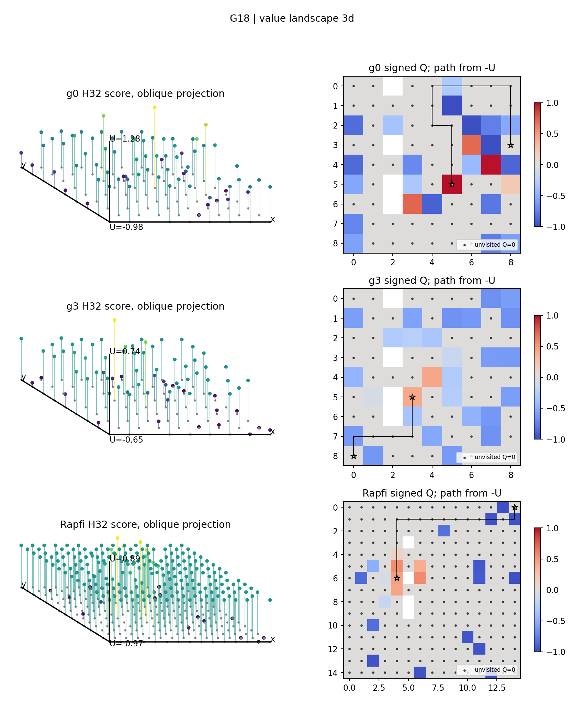
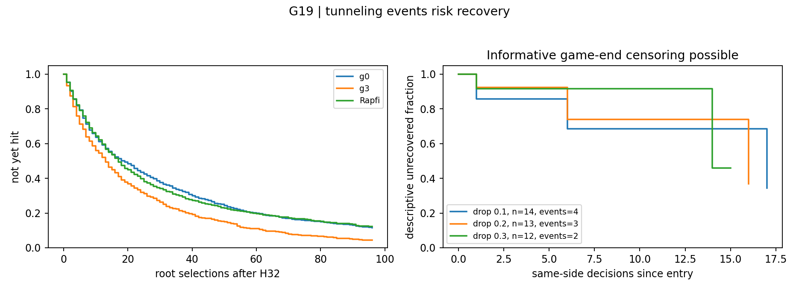
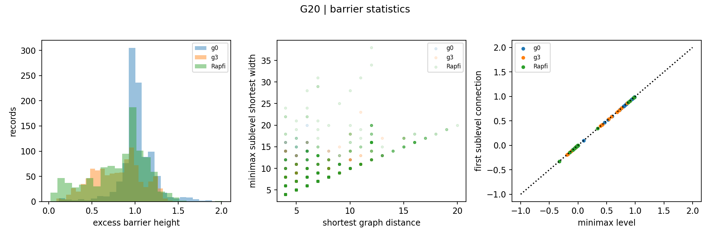
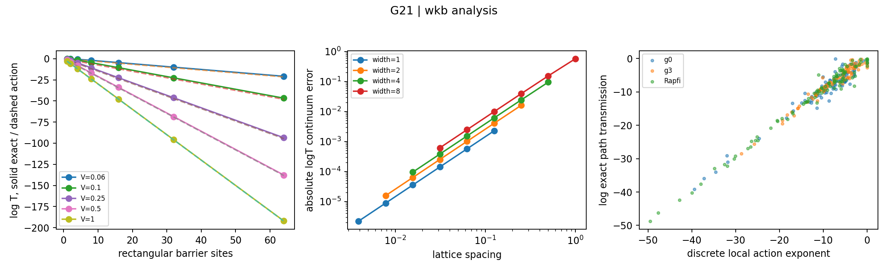
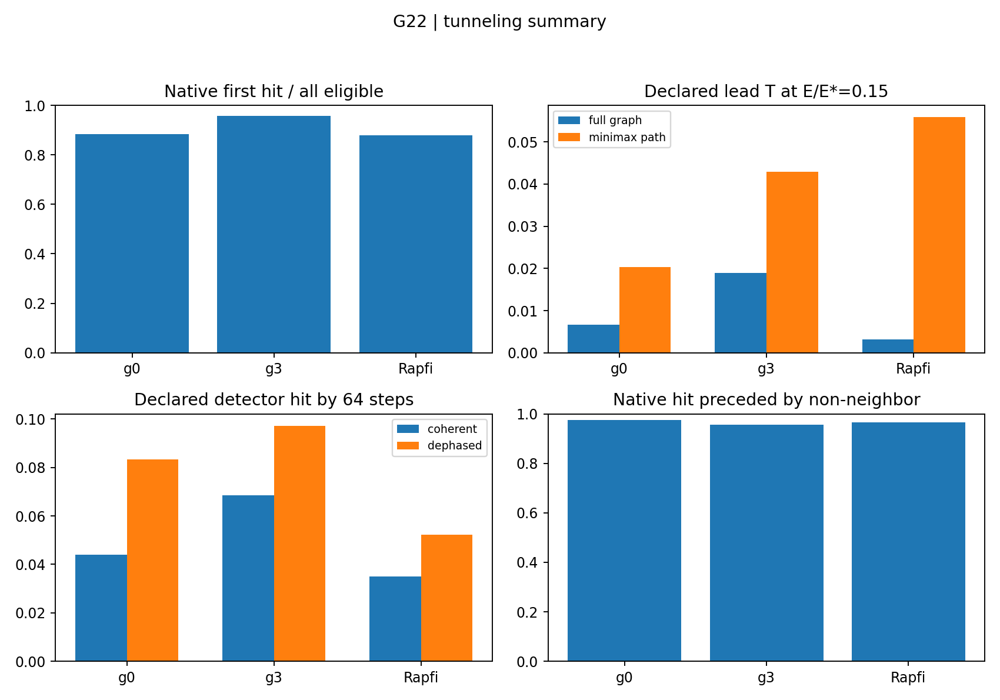
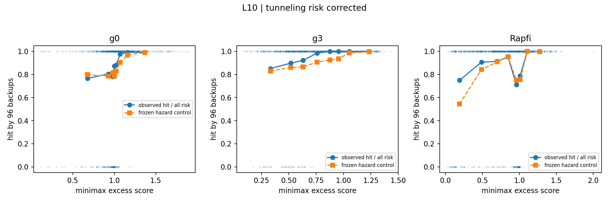
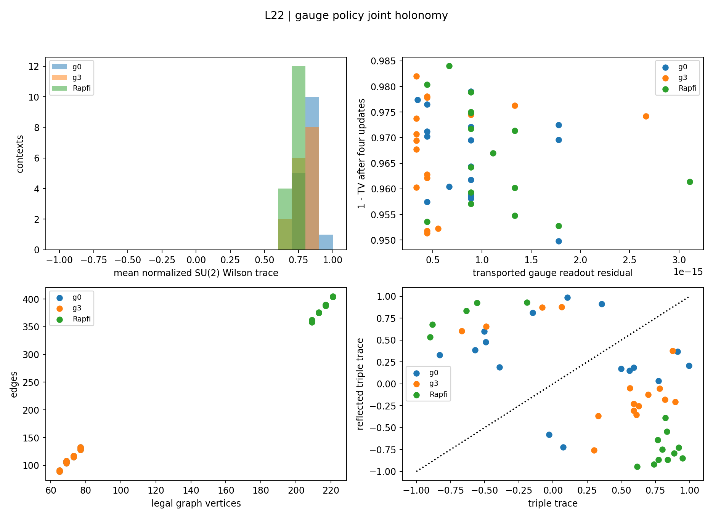
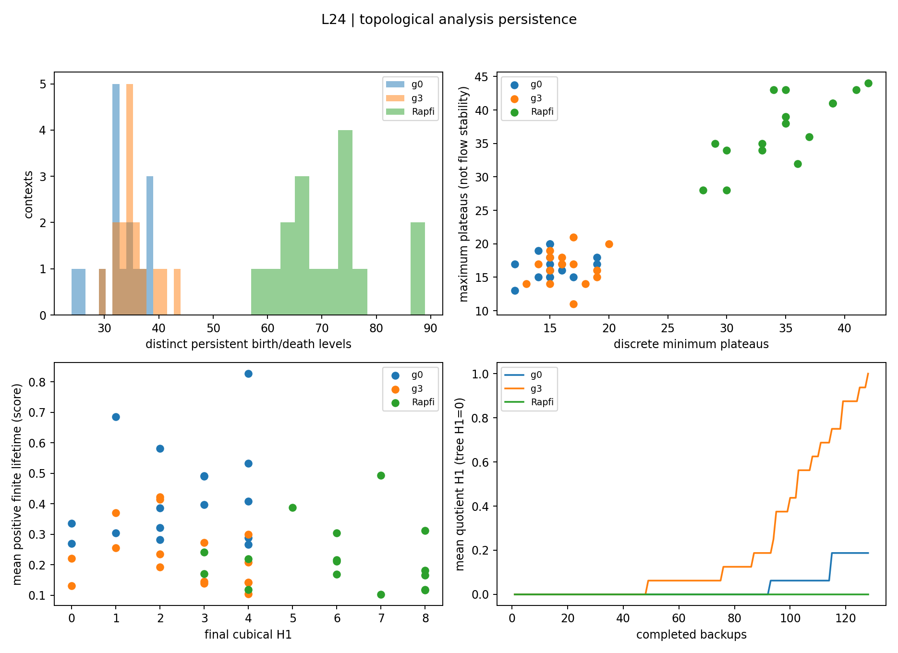

# MQFT original structural output report

RESTORE88 · RESTORE69 scientific authority

Eight item-specific static figures, full data and explicit limitations. Original claims and corrected output artifacts are tracked separately.

## G18

**Original acceptance:** Reproduce actual signed Q/score landscape with explicit board/time and legal mask; separate 3D rendering and physical potential.

**Method:** Signed Q and actual U at H32 with all legal actions, fixed oblique projection of sampled (x,y,U), Q heatmap and minimax path.

**Result:** 96 native representative contexts, source/target fixed at H32, score identity exact. Three predetermined core0 examples.

**Limit:** Matplotlib Axes3D unavailable; static oblique 3D projection, no smooth interpolation or interactive surface. Q=0 for unvisited is initialization.

[PDF](plots/G18_value_landscape_3d.pdf) · Data: LANDSCAPE88.json

**Disposition:** ACCEPTED_CORRECTED_SCOPED_ARTIFACT; original physical scientific claim NOT_CERTIFIED.

## G19

**Original acceptance:** All risk-set entries and first hit/recovery including censoring; same-side actual value, not postselected passage probability.

**Method:** Full actual risk-set survival and same-side recovery, threshold sensitivity, all censored/non-entry rows.

**Result:** 3071 eligible native roots; 16 real historical games, threshold .2:13 entrants,3 recoveries,10 censored,3 nonentry.

**Limit:** Native first-selection clock and same-side game decision clock differ; game-end censoring may be informative.

[PDF](plots/G19_tunneling_events_risk_recovery.pdf) · Data: BARRIER88.json, RECOVERY88.json

**Disposition:** ACCEPTED_CORRECTED_SCOPED_ARTIFACT; original physical scientific claim NOT_CERTIFIED.

## G20

**Original acceptance:** Define height/width using a specified graph and potential, verify minimax certificates, separate root draws from local motion.

**Method:** Explicit nearest-neighbor legal graph, V=-U, minimax excess height and shortest width at sublevel threshold; certificate via Kruskal and below-threshold BFS.

**Result:** 3071 native certificates; all96 rep0 threshold mergers exact, prior scalar and risk features exact.

**Limit:** Score units only, local geometric path not native jump sequence.

[PDF](plots/G20_barrier_statistics.pdf) · Data: BARRIER88.json, TOPOLOGY88.json

**Disposition:** ACCEPTED_CORRECTED_SCOPED_ARTIFACT; original physical scientific claim NOT_CERTIFIED.

## G21

**Original acceptance:** Specify kinetic term, energy, units and exact boundary scattering, validate lattice/continuum WKB error regime; native calibration separate.

**Method:** Explicit declared hopping/energy/units and lead boundary exact scattering; lattice transfer, rectangular and continuum WKB controls, actual path action error.

**Result:** 96 graph references x3 energies; dense solve/expm subset12, max1.26e-14; all prior controls identical.

**Limit:** Local WKB exponent lacks general prefactor/interference; no native physical calibration.

[PDF](plots/G21_wkb_analysis.pdf) · Data: TRANSPORT88.json

**Disposition:** ACCEPTED_CORRECTED_SCOPED_ARTIFACT; original physical scientific claim NOT_CERTIFIED.

## G22

**Original acceptance:** Reconstruct risk, landscape, exact transport and coherent/dephased controls; no native quantum tunneling without operational phase law.

**Method:** Integrated actual landscape, risk, barrier geometry, exact lead T, coherent/dephased monitored detector and nonneighbor native hits.

**Result:** 96 model contexts, 3072 native risk records, all controls preserved; four-panel final summary.

**Limit:** Native and model clocks/units/protocols distinct; no physical quantum tunneling inference.

[PDF](plots/G22_tunneling_summary.pdf) · Data: LANDSCAPE88.json, BARRIER88.json, TRANSPORT88.json, RECOVERY88.json

**Disposition:** ACCEPTED_CORRECTED_SCOPED_ARTIFACT; original physical scientific claim NOT_CERTIFIED.

## L10

**Original acceptance:** Use complete event-risk and recovery records, explicit barrier geometry and model transmission; retain informative censoring.

**Method:** Actual barrier-height vs all-risk hit rate, include censoring and frozen comparison; original postselected tunneling probability replaced by explicitly labelled empirical risk.

**Result:** 3072 paths;3071 entrants,2783 hits,288 censored,1 nonentry; 16 historical games in RECOVERY88 and coherent reference in TRANSPORT88.

**Limit:** No native tunneling probability or physical propagation; descriptive bins not causal.

[PDF](plots/L10_tunneling_risk_corrected.pdf) · Data: BARRIER88.json, RECOVERY88.json, TRANSPORT88.json

**Disposition:** ACCEPTED_CORRECTED_SCOPED_ARTIFACT; original physical scientific claim NOT_CERTIFIED.

## L22

**Original acceptance:** True unitary oriented links on specified actual graph; normalized Wilson and joint holonomy, covariant field/effect stability, topology; native operational identification separate.

**Method:** All three original panels recreated (mean normalized Wilson trace, gauge readout error vs stability, graph V/E) plus joint orientation. True unitary links, all fundamental loops and transported effects.

**Result:** 48 actual legal graph contexts, 4005 holonomies; all rank3. Gauge error 3.11e-15; fixed-effect change is a changed probe.

**Limit:** Declared local SU2 model, no native physical gauge identification.

[PDF](plots/L22_gauge_policy_joint_holonomy.pdf) · Data: GAUGE88.json, INDEPENDENT88.json

**Disposition:** ACCEPTED_CORRECTED_SCOPED_ARTIFACT; original physical scientific claim NOT_CERTIFIED.

## L24

**Original acceptance:** Define actual tree/quotient/filtration, persistence and critical point definition; distinguish cycles from continuum Morse/topological phase.

**Method:** Actual prefix tree and quotient, graph/cubical lower-star filtration, GF2 birth-death pairs and explicit discrete critical thresholds and plateau extrema; original stability panel corrected.

**Result:** 144 contexts, 25648 threshold checks, 6048 inclusion ranks and144 dual-hole checks. Chronological quotient H1 births19; final legal graph H1 sum12064 vs filled531.

**Limit:** Local minimum/maximum plateau is not Lyapunov stability; no continuum Morse index or topological phase.

[PDF](plots/L24_topological_analysis_persistence.pdf) · Data: TOPOLOGY88.json, INDEPENDENT88.json, PERSISTENCE_RANK88.json

**Disposition:** ACCEPTED_CORRECTED_SCOPED_ARTIFACT; original physical scientific claim NOT_CERTIFIED.
