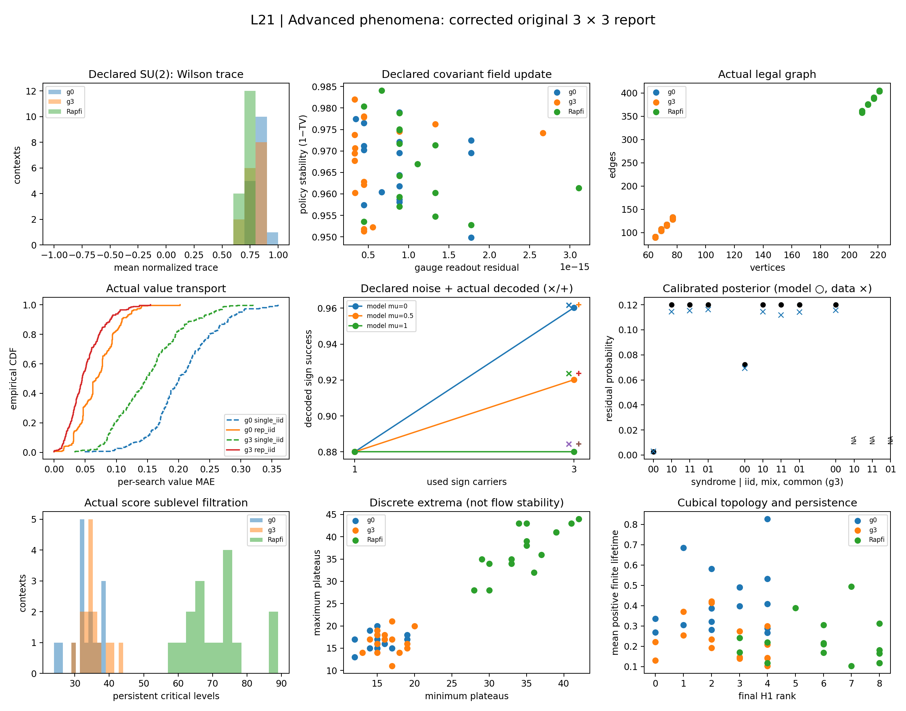
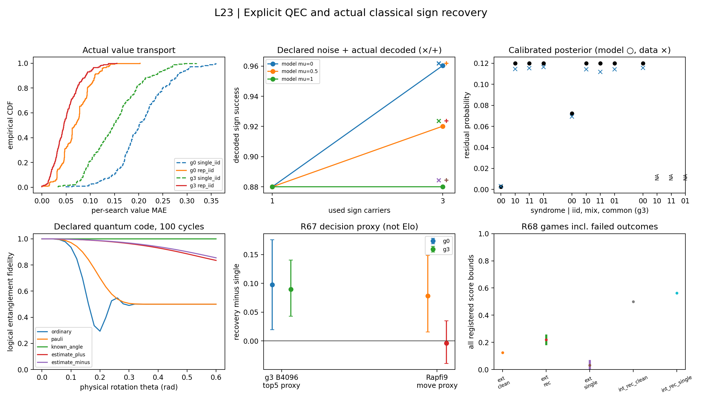

# MQFT advanced quantum original output reconstruction

RESTORE89; R69 research authority. Corrected finite model/native artifact scope, not original physical certification.

## L21

**Acceptance:** Join gauge, recovery, topology and other advanced panels only for explicit operator/state and actual graph; preserve model-specific limitations.

**Method:** Recreate original 3x3 gauge, QEC and topology report, R88 actual graphs/declared SU2 connection and discrete persistence, R89 explicit actual sign and declared channel.

**Result:** R88 L22/L24 corrected component identities verified, L23 dedicated output reconstructed; nine panels preserve separate native and model quantities.

**Limit:** No shared physical joint state or native gauge/coherence identification; discrete extrema not dynamical stability.

[PDF](plots/L21_advanced_quantum_phenomena.pdf) · Evidence: QEC89.json, SUMMARY89.json, INDEPENDENT89.json

**Decision:** ACCEPTED_CORRECTED_SCOPED_ARTIFACT. Original science NOT_CERTIFIED.

## L23

**Acceptance:** Define code, fault channel, syndrome and correction success/utility with same evaluator; distinguish actual sign transport from hardware QEC.

**Method:** Exact repetition code and stabilizer recovery, syndrome-conditioned MAP posterior, actual native sign fault rates and redundancy, coherent conditional recovery and matched native game evidence.

**Result:** 3200 R67 roots and80 R68 games,579026 eval records, zero cut error; 24 posterior cases and465 repeated-channel checks. Original value error, redundancy, confidence panels plus channel/utility diagnostics.

**Limit:** Classical sign transport is not hardware QEC; quantum repetition code protects X errors only, known-angle inversion requires calibration; no general strength admission.

[PDF](plots/L23_quantum_error_correction.pdf) · Evidence: QEC89.json, NATIVE89.json, SUMMARY89.json, INDEPENDENT89.json, SOURCE_CORRECTIONS89.json

**Decision:** ACCEPTED_CORRECTED_SCOPED_ARTIFACT. Original science NOT_CERTIFIED.
