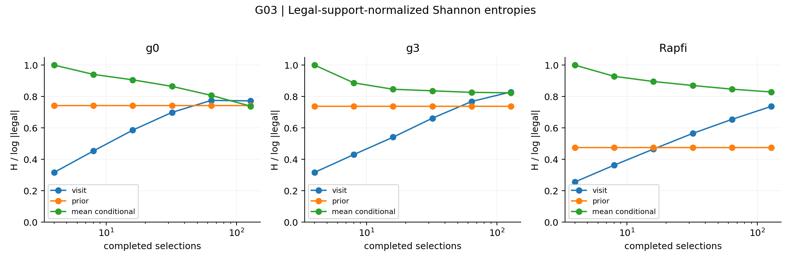
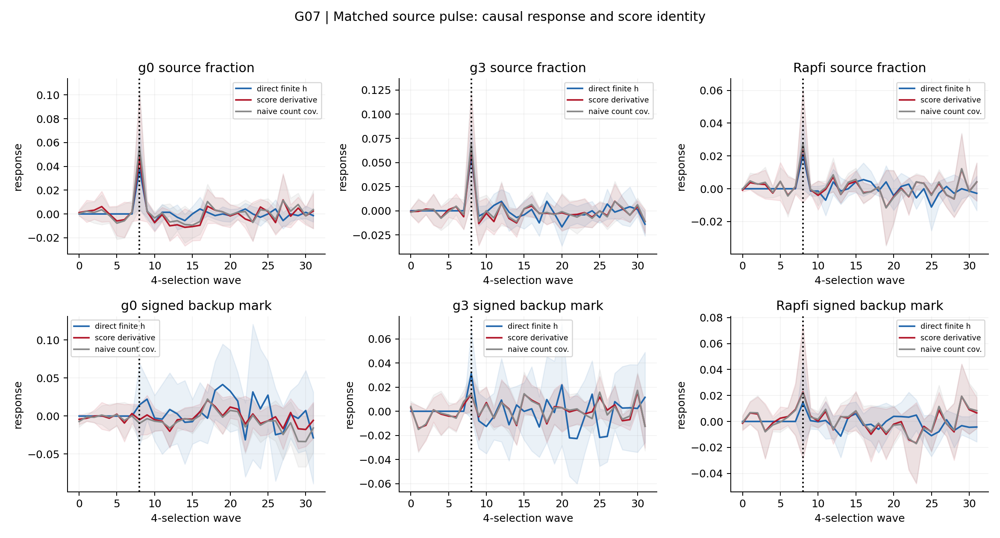
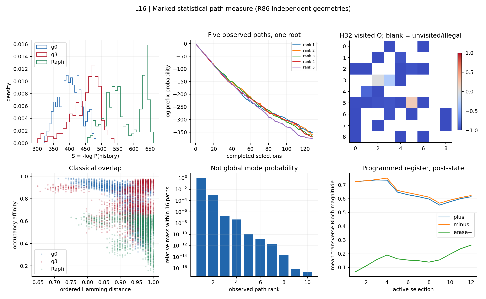
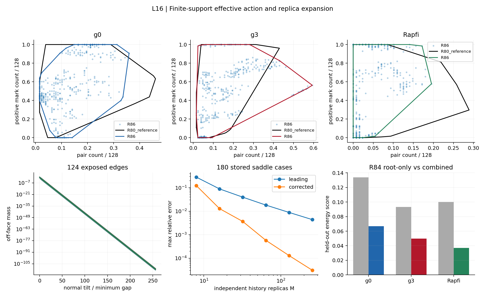
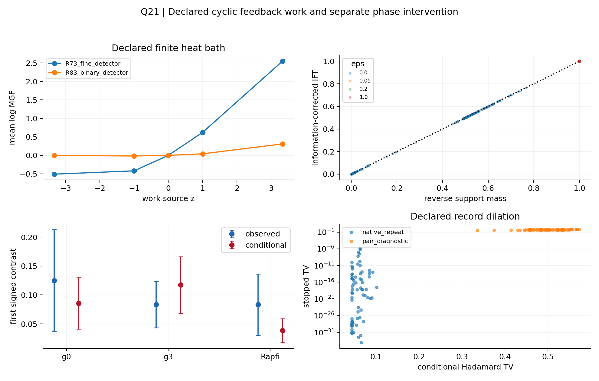
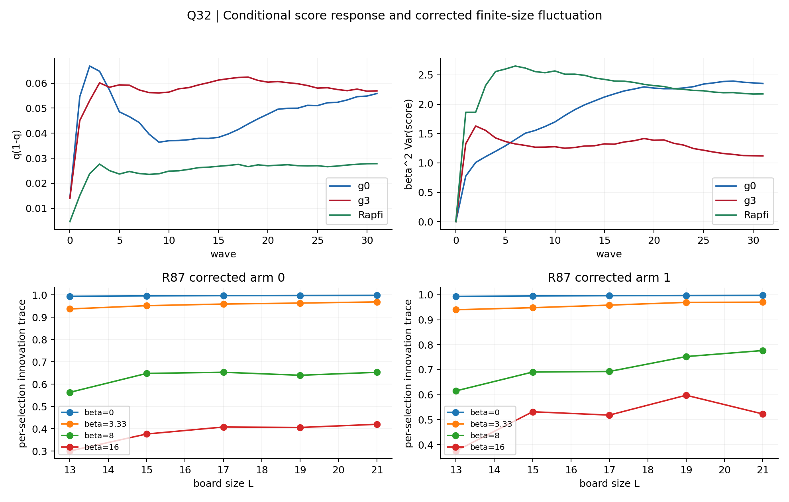
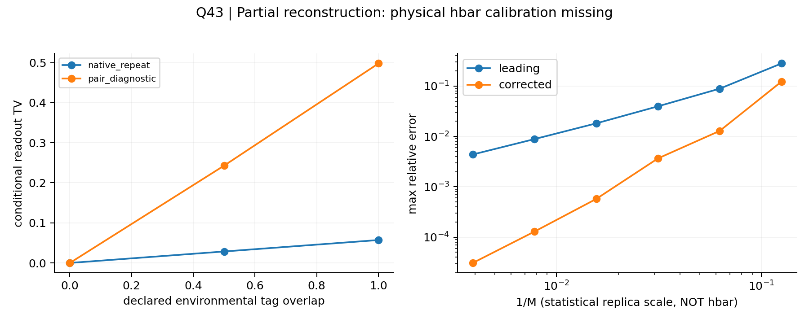

# RESTORE90 | Statistical action and work: original-output reconstruction

R69 scientific charter preserved. Five corrected-scoped artifacts, one partial. These are not certifications of the original physical hypotheses.

## G03 | ACCEPTED_CORRECTED_SCOPED_ARTIFACT

Reproduce visit/prior/conditional Shannon entropy with legal support and clock; no thermodynamic equivalence without state map.

Visit/prior/mean conditional Shannon entropy at actual cuts with legal support.

R86 heldout geometry, six cut clocks, all three evaluator families.

**Limits:** Not thermodynamic entropy without state identification.

[Vector PDF](plots/G03_entropy.pdf)

## G07 | ACCEPTED_CORRECTED_SCOPED_ARTIFACT

Measure direct causal field response with same score law and mark, distinguish connected fluctuation and FDT; independent geometry.

Actual matched +/-0.35 source pulse and exact path likelihood score, naive covariance and predictable drift comparison.

2304 paths; 768 matched prefix triples; 16 root blocks per family.

**Limits:** Finite contrast versus derivative distinguished; no equilibrium FDT.

[Vector PDF](plots/G07_response.pdf)

## L16 | ACCEPTED_CORRECTED_SCOPED_ARTIFACT

Normalized full-support marked path measure with action, overlaps and complex readout where specified; controlled 1PI/loop expansion and independent prediction.

Actual ordered marked law and log likelihood, classical overlaps, visited Q, programmed phase post-state, finite-face 1PI and statistical replica expansion, R84 held-out prediction.

7488 actual clean histories, 52320 within-root overlap pairs, 261 interior and 372 face tilts; 180 coefficient checks, six independent FFTs.

**Limits:** Empirical support distinct from native legal support; coherent dilation declared, no physical hbar; one heldout cohort, no matched-cost transfer.

[Vector PDF](plots/L16_path_integral.pdf)

[Vector PDF](plots/L16_effective_action.pdf)

## Q21 | ACCEPTED_CORRECTED_SCOPED_ARTIFACT

Derive normalized path measure and work generating function for identified Hamiltonian/protocol; complex action separately with operational phase.

Normalized marked law; explicit diagonal Hamiltonian cyclic feedback work generator; separate complex record amplitude action and operational programmed phase.

832 exact work cases, 3456 phase paths and 72 declared record contexts, matched readout and stopped mass.

**Limits:** Hamiltonian model declared, not native heat/work; complex dilation nonunique; physical hbar uncalibrated.

[Vector PDF](plots/Q21_work_path.pdf)

## Q32 | ACCEPTED_CORRECTED_SCOPED_ARTIFACT

Measure direct conjugate source response, compare path-score and fluctuation; thermal susceptibility/C only if calibrated T.

Same-wave exact conjugate source derivative and actual response, score Gibbs capacity, R87 corrected innovation trace across size.

2304 pulse paths and 40 inherited corrected finite-size aggregate strata checked.

**Limits:** Dimensionless score beta only, no calibrated T or physical heat capacity; critical gate 0/8.

[Vector PDF](plots/Q32_susceptibility.pdf)

## Q43 | PARTIAL_CORRECTED_ARTIFACT_CALIBRATION_UNRESOLVED

Define complex path amplitude, measure, action and independently calibrated hbar; compare actual finite conditional instrument and coherent readout.

Complex record amplitude/action with explicit tagged readout and dimensionless 1/M replica limit, no fitted hbar.

72 declared record contexts and 180 statistical replica checks.

**Limits:** PARTIAL: independently calibrated physical hbar and native quantum-classical limit absent.

[Vector PDF](plots/Q43_partial_hbar.pdf)

## Derivation and reproducibility

[Theory](THEORY.md) · [Audit](INDEPENDENT90.json) · [Convergence](CONVERGENCE90.json) · [Item decisions](ITEM_RECONSTRUCTION90.json) · [Drift watchdog](DRIFT_WATCHDOG.md).

No new native paths, physical hbar, calibrated temperature, equilibrium FDT, broad prediction transfer, or original scientific certifications.
